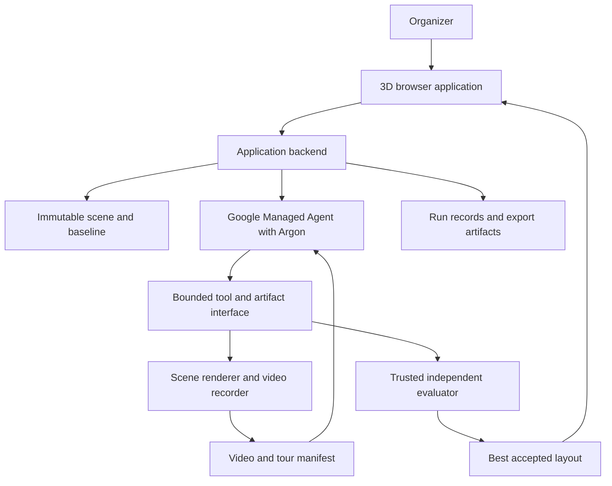

# VenuePilot Product Requirements and Scope

**Version:** 1.0  
**Date:** October 25, 2026  
**Primary track:** Problem Statement Two — More Dimensions  
**Build budget:** Six hours, including testing and demo preparation  
**Primary deliverable:** A working browser application with a verified agent repair loop  
**Intended readers:** Product, frontend, agent integration, verification, and demo contributors

VenuePilot helps an occasional event organizer improve a seating plan before setting up a room. The organizer supplies a small venue configuration and a fixed guest count. The application produces a 3D seating layout, measures views of the stage, and uses Gemini 4 Argon inside a Google Managed Agent to inspect a rendered walkthrough and propose changes. Independent geometry checks decide whether those changes improve the layout while preserving the requirements.

This document controls the hackathon scope. The MVP is **one rectangular room, one fixed stage, fixed pillars, identical chairs, a fixed guest count, and a bounded visual repair loop**. A complete, measurable loop takes priority over additional event-planning features.

The scope and default values below are project decisions. They are not measured results, building standards, or promises of production readiness. Provider details attributed to the supplied builder guide must pass the integration checks in Section 14 before implementation depends on them.

## Contents

- [1 Product decision and scope rules](#1-product-decision-and-scope-rules)
- [2 Problem and intended user](#2-problem-and-intended-user)
- [3 Hackathon requirements](#3-hackathon-requirements)
- [4 Goals and success criteria](#4-goals-and-success-criteria)
- [5 Included and excluded work](#5-included-and-excluded-work)
- [6 User experience](#6-user-experience)
- [7 Functional requirements](#7-functional-requirements)
- [8 Scene and geometry specification](#8-scene-and-geometry-specification)
- [9 Evaluation and candidate acceptance](#9-evaluation-and-candidate-acceptance)
- [10 Agent responsibilities and behavior](#10-agent-responsibilities-and-behavior)
- [11 Architecture and execution boundaries](#11-architecture-and-execution-boundaries)
- [12 Data contracts](#12-data-contracts)
- [13 Run lifecycle and recovery](#13-run-lifecycle-and-recovery)
- [14 Provider integration and feasibility checks](#14-provider-integration-and-feasibility-checks)
- [15 Performance and operating limits](#15-performance-and-operating-limits)
- [16 Evaluation protocol](#16-evaluation-protocol)
- [17 Acceptance test matrix](#17-acceptance-test-matrix)
- [18 Six hour delivery plan](#18-six-hour-delivery-plan)
- [19 Demo and submission requirements](#19-demo-and-submission-requirements)
- [20 Risks and responses](#20-risks-and-responses)
- [21 Scope change control](#21-scope-change-control)
- [22 Future product work](#22-future-product-work)
- [23 Assumptions and decisions to confirm](#23-assumptions-and-decisions-to-confirm)
- [24 Definition of done](#24-definition-of-done)
- [25 Source notes](#25-source-notes)

## 1 Product decision and scope rules

### 1.1 Product statement

For an organizer planning a small seated presentation, VenuePilot identifies seats with obstructed stage views and proposes a better arrangement that keeps every guest seated. The organizer can inspect the evidence from each affected seat and choose which verified layout to use.

### 1.2 Scope authority

This PRD is the source of truth for MVP behavior. Its numerical constants must be represented in one versioned configuration module rather than copied independently into prompts, rendering code, and scoring code.

Requirement priority has the following meaning:

| Priority | Meaning | Delivery rule |
| --- | --- | --- |
| P0 | Required for the complete MVP | Must pass acceptance before the project is called complete |
| P1 | Optional improvement | Start only after the P0 path works end to end and has passed its critical checks |
| Later | Future product work | Excluded from the six-hour build |

The managed integration, actual visual inspection, and independent verification are P0. Replacing any of them with a mock is a scope downgrade that must be recorded and disclosed. A fallback can preserve a useful demo without satisfying the full MVP.

### 1.3 Fixed product decisions

- The primary customer is an occasional organizer of a small talk, presentation, or community performance.
- The primary task is improving modeled stage visibility while preserving the requested seating capacity.
- The main interface is the interactive 3D room and the view from a selected seat.
- The default scenario contains 60 seats. Supported configurations contain 12 to 80 seats, subject to geometric feasibility.
- One managed agent conducts a run. Multiple cooperating agents and companion models are optional future work.
- The agent changes layout data through bounded operations. It cannot change the evaluator or render application during a user run.
- The model receives actual rendered visual evidence. Numerical feedback alone does not satisfy the visual-loop requirement.
- A useful outcome may be an improvement, a verified lack of improvement, or an explanation that the current constraints are infeasible.

### 1.4 Scope reduction order

If time becomes constrained, remove P1 work first. Then reduce supported room variations, visual detail, clip resolution, or the maximum repair rounds. Preserve the complete loop, seat count, independent checks, seat-level inspection, and honest reporting.

Do not spend the final hour adding features. Reserve it for testing, a working live demo, and submission assets.

## 2 Problem and intended user

### 2.1 Primary persona

The primary user is a community organizer or small-event coordinator arranging approximately 30 to 80 seats in a room with pillars and a stage or presentation area. They have basic measurements and a guest count, but do not regularly use professional CAD tools.

Before judging, identify one actual person who fits this description and ask them to review the workflow if someone is available. Do not invent a customer name, interview, endorsement, or validated willingness to pay.

### 2.2 User problem

A floor plan can fit the requested number of chairs while concealing poor views. The organizer may discover these problems only after arranging furniture or after guests arrive. Moving chairs can improve some views while creating overlaps, reducing capacity, or occupying an aisle.

The user needs a way to answer three questions:

1. Which seats have a poor view in the current plan?
2. What arrangement improves those views while retaining the practical constraints?
3. What evidence supports the proposed improvement?

Professional event-design products already include seating layouts, 3D visualization, and sightline checks. VenuePilot's proposed advantage is an approachable workflow in which an agent inspects the room and performs revisions for the organizer. The existence of this workflow does not establish demand for this particular product.

### 2.3 Job to be done

“When I arrange seating for a presentation, help me identify and repair obstructed views before setup so I can choose a plan with evidence rather than discover the problem during the event.”

### 2.4 User value and boundaries

The MVP supports a planning decision using a simplified geometric model. Its output is a seating proposal, a visibility comparison, and a reproducible record of the changes. It does not certify a venue, calculate legal occupancy, simulate emergency evacuation, or establish accessibility compliance.

## 3 Hackathon requirements

### 3.1 Track fit

VenuePilot targets **More Dimensions** through the following observable sequence:

1. The system generates a 3D seating plan.
2. A renderer produces a walkthrough of that plan.
3. Argon inspects the actual walkthrough against the organizer's goal.
4. The managed agent proposes and applies an allowed layout revision.
5. The system rerenders the revision and independently verifies the result.

One complete cycle must run with real inputs during judging. A precomputed animation or a numerical optimizer with a chat explanation does not demonstrate the required behavior.

The project does not claim to complete Problem Statement One merely because Argon helped write its source code. A separate substantial engineering task and baseline would be needed for that claim.

### 3.2 Rules incorporated from the participant guide

| Event requirement | Product or delivery implication |
| --- | --- |
| Public source repository | Prepare a public-ready repository, license, setup instructions, and sanitized examples |
| Teams of one to four | Plan responsibilities within a maximum four-person team |
| New work and clear attribution | Identify code, features, and integrations built during the event; distinguish dependencies and starter code |
| Rights to code, data, and assets | Use owned or appropriately licensed source and simple procedural geometry; document attribution |
| A dashboard cannot be the main feature | Make the 3D seating experience and autonomous repair the central interaction |
| One-minute submission video | Produce a short recording of the specific functionality built during the event |
| Approximately three-minute live demo | Support a real-input workflow that can finish within the judging slot |
| Accessible submission links and complete team listing | Check repository visibility, video access, and team membership before submission |

The participant guide also excludes standalone image analyzers. VenuePilot must perform a full creation and repair workflow; visual analysis is an intermediate step in the working product.

### 3.3 Judging alignment

Round one weights are 50% working live demo, 25% problem and usefulness, 15% originality, and 10% pitch clarity. The finalist round uses the same categories with equal weighting. Build decisions should serve these criteria without sacrificing correctness.

| Criterion | Evidence VenuePilot must show |
| --- | --- |
| Working live demo | A genuine managed run, actual rendered input, a proposed edit, independent checks, and the resulting scene |
| Problem and usefulness | A clear organizer persona and an understandable obstructed-seat problem |
| Originality | Explain how multimodal inspection and tool execution revise a generated 3D environment; avoid claiming seating optimization itself is new |
| Pitch clarity | Show the affected seat, the repair, and the preserved constraints without slides |

The separate Best Use of Managed Agents prize is an additional target. Qualifying evidence must show real use of the hosted service, not merely a locally implemented loop named “managed.”

### 3.4 Timing

The supplied schedule lists kickoff at 10:00 AM Pacific, hacking from 10:30 AM, and submissions due at **5:00 PM Pacific on October 25, 2026**. This gives six and a half hours between the listed hacking start and submission deadline.

The project retains a six-hour total delivery budget. If starting at 10:30 AM, target completion by 4:30 PM and use the remaining 30 minutes for submission and contingencies. If starting later, work backward from the official deadline and apply Section 1.4. Verify organizer announcements for changes.

## 4 Goals and success criteria

### 4.1 Product goals

- Let an organizer identify a blocked view without understanding a technical score.
- Improve modeled visibility without removing guests or moving fixed structures.
- Make proposed changes inspectable and reversible.
- Finish a bounded agent run predictably enough for a live demonstration.
- Preserve evidence that another developer can use to reproduce the scores.

### 4.2 Primary outcome metrics

| Metric | Definition | Role |
| --- | --- | --- |
| Clear-view seat count | Seats whose view score is at least 8 out of 9 samples | Primary optimization objective |
| Mean view score | Mean fraction of visible, in-view target samples across all seats | Secondary objective |
| Minimum seat score | Lowest individual seat score | Third comparison criterion |
| Capacity preservation | Candidate seat count equals requested seat count | Hard requirement |
| Constraint violations | Failed room, collision, aisle, identity, or movement checks | Must be zero for an accepted candidate |
| Run duration | Wall time from submission to terminal run state | Operational measure |

### 4.3 Project success targets

These are targets to test, not results to put into a pitch before measurement:

- Every accepted candidate passes all hard constraints.
- Every reported score can be reproduced from saved scene data and evaluator version.
- At least two of three frozen challenge rooms show a higher clear-view seat count after the bounded repair process.
- No frozen challenge room ends with a lower accepted score than its starting layout.
- A default live run completes one real visual repair cycle within 150 seconds, with enough room for a short introduction and explanation.
- The organizer can select an affected seat, understand the before view, and inspect the after view with minimal instruction.

Failure to improve a valid layout is an evaluation result. It must not be concealed by editing the baseline, changing thresholds, reducing capacity, or substituting a different room.

## 5 Included and excluded work

### 5.1 P0 included work

- Three small, predefined room configurations.
- A form for supported room dimensions and guest count.
- One fixed stage and zero to three cylindrical pillars per room, provided through presets or validated configuration data.
- Identical chairs organized into fixed membership groups.
- A deterministic baseline generator.
- A 3D room view and seat-level perspective inspection.
- A categorical seat heatmap backed by a numerical evaluator.
- A short, reproducible recorded inspection tour.
- Google-hosted Antigravity Managed Agent execution with Argon.
- Structured, bounded layout edits.
- Independent candidate validation and comparison.
- Progress, failure, cancellation, and no-improvement states.
- Saved baseline, attempts, best layout, evidence references, and provider run identifiers.
- A simple before/after comparison within the 3D application.
- Local export of a run bundle sufficient to reproduce the evaluation.
- Public-repository documentation, tests, attribution, and demo assets.

### 5.2 P1 optional work

- A matching after-view video using the original baseline tour's seat IDs.
- A human-readable Markdown summary exported from the saved run bundle.
- Additional familiarization controls such as a keyboard shortcut to the next affected seat.
- A manually adjustable pillar position control, with complete revalidation.
- A fresh-regeneration control experiment using the same model budget.
- A brief organizer usability session if a suitable person is readily available.

### 5.3 Explicit exclusions

The following must not enter the hackathon MVP:

- Room scanning, photogrammetry, SLAM, or reconstruction from photographs or video.
- CAD, BIM, IFC, PDF floor-plan, or arbitrary 3D asset import.
- Arbitrary room shapes, multiple floors, stairs, sloped seating, or balconies.
- Different furniture catalogs, round-table dinners, wedding guest assignments, or ticketing.
- Simulated crowds, evacuation predictions, queue prediction, or pedestrian behavior models.
- Building-code, fire-code, occupancy, or accessibility certification.
- Acoustics, lighting optimization, structural engineering, or projector readability analysis.
- Audience heads, bodies, dynamic performers, or other people as sightline occluders.
- Voice interfaces, generated music, generated video, and decorative image generation.
- Accounts, billing, organizations, collaboration, or a production multi-tenant backend.
- Booking equipment, purchasing furniture, contacting organizers, or changing external venue systems.
- Autonomous source-code modification during a user's optimization run.
- A large analytics dashboard, a general agent platform, or a custom orchestration framework.

### 5.4 Simplified visibility model

The MVP measures views of a fixed target region above the stage, obstructed by modeled fixed geometry and limited by the seat's viewing direction. It does not estimate what a person will see through an audience. The UI and exported metadata must state this limitation near the score explanation.

## 6 User experience

### 6.1 Main application layout

The primary screen contains a large 3D viewport, a compact setup panel, selected-seat details, and a collapsible attempt history. Scene interaction remains usable while a run is in progress, although configuration edits are locked for that run.

The initial screen must show a populated room and a visible stage. Do not open on an empty dashboard, account screen, or chat conversation.

### 6.2 Setup flow

1. The organizer chooses a room preset.
2. They review or change supported room dimensions and guest count.
3. The application validates values and builds the baseline.
4. The organizer sees the seat count, current view assessment, and fixed structures.
5. They select **Improve views** to begin a managed run.

Keep configuration within the supported domain. Advanced settings, scoring weights, model names, and provider parameters belong in developer configuration, not the organizer's main flow.

### 6.3 Seat inspection

Selecting a chair highlights it and exposes its stable seat ID, score, classification, and obstructing objects. **View from this seat** changes the camera to its eye position and seating direction. **Back to room** restores the overview.

Seat-level inspection uses the square camera projection specified in Section 8.8, including when the application window is wide. This keeps the view shown to the organizer consistent with the scored viewing angles.

Use both labels and color:

- Clear: at least 8 of 9 target samples visible and in view.
- Partial: 4 to 7 samples visible and in view.
- Obstructed: 0 to 3 samples visible and in view.

The seat list provides an accessible alternative to selecting small 3D objects. A selected seat must remain identifiable when switching between baseline and improved layouts.

### 6.4 Optimization experience

Show factual stages such as **Preparing scene**, **Recording seat views**, **Agent inspecting walkthrough**, **Testing layout change**, and **Complete**. Do not invent percentage progress or display private model reasoning.

During a run, show the last verified layout. A rejected candidate can appear only in a labeled attempt inspection view; it must never replace the accepted layout silently.

Display concise agent findings grounded in the evidence, for example: “The left pillar blocks part of the presentation area from seats L04 through L06.” A finding must reference real seat IDs and an actual artifact or timestamp.

### 6.5 Result experience

The result screen preserves the 3D viewport and adds:

- Baseline and best-layout toggles.
- Requested and actual seat count.
- Clear-view seat count and mean view score before and after.
- Whether all modeled constraints pass.
- A short explanation of the accepted changes.
- Attempt history with accepted or rejected status and reasons.
- **Export run** and **Start new run** controls.

If no improvement is accepted, retain the baseline and say **No verified improvement found within this run**. Do not describe a rejected change as an improvement.

### 6.6 Infeasible input

If the baseline generator cannot fit the requested seats within the current model, explain the conflict and let the organizer edit the room or guest count. Never silently reduce the guest count. An inability of this generator to find a fit must be described as a search failure, not proof that no possible arrangement exists.

## 7 Functional requirements

Each requirement below is P0 unless explicitly marked P1. Acceptance tests are consolidated in Section 17.

### FR01 Configure a supported scenario

The app must accept room width, depth, height, and integer guest count within Section 8's bounds. Presets supply the stage and pillar configuration. Invalid inputs must produce field-level errors before rendering or provider calls.

### FR02 Generate a repeatable baseline

The app must generate the same seat groups and transforms for the same normalized scene configuration, generator version, and seed. It must validate the baseline before allowing optimization. Baseline generation uses a conventional row layout and deterministic fitting rules; it must not deliberately place invalid chairs to manufacture improvement.

### FR03 Render the room

The renderer must show walls or clear room boundaries, a floor, stage, pillars, and all requested chairs. Chairs must expose stable selection IDs. Decorative geometry must not change authoritative collision or scoring geometry.

### FR04 Explain individual seat scores

Each seat must expose the number of visible samples out of nine, the classification, and the blocking object IDs or field-of-view failures. The score legend must describe the fixed-obstacle model.

### FR05 Provide seat and overview cameras

The user must be able to inspect any seat at the fixed eye height and return to an overview. Camera positions used for evidence must derive from saved seat transforms, not from manually arranged screenshots.

### FR06 Start a genuine managed run

**Improve views** must create a backend run linked to a real Antigravity interaction identifier. The frontend must not possess provider credentials. The run must operate on an immutable scene snapshot and return immediately with a local run ID while the provider work continues.

### FR07 Inspect real visual evidence

The managed agent must receive or access a video generated from the evaluated layout. Save the evidence mapping and whatever provider acknowledgment or tool trace is available to demonstrate that this artifact was supplied or opened. Do not claim the model watched a video solely because a filename appeared in a prompt.

### FR08 Propose bounded edits

The agent must return a structured patch using only allowed operations and existing group IDs. Malformed output, unknown IDs, nonfinite numbers, changed constants, and oversized patches must be rejected before they modify accepted state.

### FR09 Evaluate independently

Trusted code must validate geometry, score every seat, and apply the acceptance policy. Agent-written summaries and scores are advisory. The agent must have no write access to the authoritative scoring implementation, benchmark fixtures, or acceptance constants used by the controller.

### FR10 Preserve capacity and fixed structures

Every accepted candidate must retain all requested seat IDs and group memberships, room dimensions, pillar dimensions and transforms, stage position and dimensions, reserved routes, and scoring configuration. Any mismatch is a hard rejection.

### FR11 Keep the best verified layout

The controller must retain the best accepted layout after every attempt. Invalid, worse, or interrupted attempts cannot replace it. Equal-score changes follow the policy in Section 9.

### FR12 Rerender a candidate

After a valid candidate is scored, the system must render it and make the corresponding visual evidence available for the next inspection or final verification. A successful run contains evidence from both the initial and revised scene.

### FR13 Show progress and terminal states

The frontend must display current factual progress and distinguish completion, no improvement, infeasible setup, provider failure, budget exhaustion, and cancellation. It must remain responsive while waiting.

### FR14 Retain a reproducible run record

The backend must save the normalized scene, immutable baseline, proposed patches, validation results, independent scores, best layout, media references, timestamps, provider interaction IDs, and generator/evaluator versions. Saves must be atomic or otherwise resilient to partial writes.

### FR15 Compare and export

The organizer must be able to compare the same seat in the baseline and best layouts. Export a JSON run bundle and available evidence files. API keys, access tokens, and private provider configuration must never be included.

### FR16 Cancel safely

Cancellation must stop acceptance of new candidates immediately and preserve the best verified result. Attempt provider-side cancellation where supported. If remote work may continue, say so rather than claiming its billing or execution has stopped.

### FR17 Preserve decisions across refresh

With the backend still running, refreshing the page must restore the selected run and its saved status. Recovery after a backend restart must either reconcile the provider state or mark the run interrupted while preserving saved artifacts. Seamless resumption after a restart is not required.

### FR18 Separate live and replay evidence

The app may provide a saved replay as a demonstration backup. Replay must be prominently labeled, must not create fake provider events, and must never be represented as a new live run.

## 8 Scene and geometry specification

### 8.1 Units and coordinate system

- All distances use meters; all persisted rotations use degrees.
- The room occupies `x = -width/2 ... width/2`, `z = 0 ... depth`, and `y = 0 ... height`.
- The floor is `y = 0`; the stage is near `z = 0`; the audience extends toward positive `z`.
- A seat yaw of zero faces toward negative `z`. Positive yaw rotates toward positive `x`.
- The renderer converts degrees to radians at its boundary.
- Store unrounded values for evaluation. Round only display values. Normalize input dimensions to the nearest centimeter.

### 8.2 Supported input limits

| Parameter | MVP range or constant | Notes |
| --- | --- | --- |
| Room width | 8 to 20 m | Rectangular room only |
| Room depth | 10 to 25 m | Fixed level floor |
| Room height | 3 to 6 m | Must contain all fixed geometry and stage targets |
| Guest count | Integer 12 to 80 | A range check does not guarantee that a layout fits |
| Pillars | 0 to 3 | Vertical cylinders; preset/configuration supplied |
| Pillar radius | 0.2 to 0.6 m | Full room height |
| Stage width | 4 to 8 m | Must fit the room with wall clearance |
| Stage depth | 1.5 to 3 m | Supplied by preset |
| Stage height | 0.3 to 0.8 m | Supplied by preset |
| Seat footprint | 0.50 m wide by 0.55 m deep | Identical for all seats |
| Eye height | 1.15 m above floor | Fixed for every evaluated seat |
| Seat-to-seat clearance | At least 0.05 m | Geometric model parameter |
| Wall clearance | At least 0.40 m | Measured from seat footprint |
| Center aisle width | 1.20 m | Reserved rectangle centered on x = 0 |
| Rear clear strip depth | 1.00 m | Full room width at the back |
| Stage-front clear strip | 0.80 m | No chairs directly in front of the stage |
| Seat view field | 90 degrees horizontally and 90 degrees vertically | Fixed for scoring and inspection |

These clearances are chosen for the prototype. They are not asserted to satisfy a jurisdiction's requirements.

### 8.3 Reserved geometry

The center aisle runs from the front of the audience area to the rear wall. The rear strip intersects it and reaches a fixed rear entrance marker. The entrance marker is illustrative; the room boundary remains authoritative.

Pillars must not intersect the center aisle or rear strip in supported configurations. Validate this before baseline generation. Because these reserved rectangles remain fixed and clear, P0 does not require a navigation mesh or a general pathfinding system. Report **Reserved routes clear**, rather than claiming every seat is accessible or that evacuation has been modeled.

All chair footprints must remain outside reserved regions, the stage, pillar footprints, and wall-clearance boundaries. Use oriented chair rectangles and conservative, documented clearance checks. Test rotated footprints as well as seat centers.

### 8.4 Baseline layout and grouping

The baseline generator creates left and right seating blocks separated by the center aisle, starting behind the stage-front strip. It uses deterministic row and column spacing and a fixed row-major seat assignment. Any deterministic fitting search must have an explicit candidate limit and documented order.

Create stable groups such as `row-03-left`, containing one row's left-side seats. Group membership and chair count are frozen after generation. The final row may contain fewer chairs to match the requested guest count exactly.

Baseline generation can account for collisions and reserved regions. It must not optimize sightlines around pillars. This distinction makes the comparison a valid conventional layout versus a visually informed repair, rather than a comparison against an intentionally broken arrangement.

### 8.5 Allowed agent transformations

The only P0 edit is `transform_group`, which translates and rotates an existing group around its current centroid:

- Maximum eight group operations per proposal.
- Each group ID may appear at most once in a proposal.
- Translation increments are 0.05 m, with a maximum of 0.60 m along each axis per proposal.
- Rotation increments are 5 degrees, with a maximum of 10 degrees per proposal.
- Absolute group rotation is limited to 20 degrees from baseline.
- Each seat's total horizontal displacement from its baseline position is limited to 1.50 m.
- Group centroids and memberships are computed by trusted code.
- All final geometry must pass the hard constraints; quantization does not waive them.

Rotation changes each chair's position relative to the centroid and its yaw. The renderer and evaluator use the resulting authoritative seat transforms. The agent cannot resize chairs, change eye height, move pillars, enlarge the stage target, modify viewing angles, delete seats, or edit reserved regions.

### 8.6 Stage target samples

Define a fixed vertical target plane at the front edge of the stage. Sample nine points formed by three horizontal positions and three heights:

- Horizontal positions relative to stage center: `-0.35 × stageWidth`, `0`, `+0.35 × stageWidth`.
- Heights above the stage surface: `0.80 m`, `1.20 m`, `1.60 m`.
- Depth: the stage's front face, with a small documented numerical offset toward the audience.

Validate that the target points lie within the room. Save the sample coordinates in the run record. The target region is a proxy for the presentation area, not a reconstruction of a particular performer or screen.

### 8.7 Numerical rules

Use one documented epsilon of 0.001 m for boundary and intersection comparisons. A tangent ray counts as blocked. Touching a forbidden region within epsilon fails clearance. The target surface itself is excluded from occlusion tests. Tests must cover boundary contacts, rotated chairs, and near-tangent pillars.

### 8.8 Camera projection consistency

Use a perspective camera with a 90-degree vertical field of view and a square 1:1 inspection viewport. This produces the specified 90-degree horizontal field of view as well. Letterbox this viewport inside a wider application or recorded frame; do not stretch the image or allow a wider camera to show targets that the evaluator classifies as out of view.

The overview camera may use a different projection because it does not represent a seat's scored view. Store the seat inspection projection and capture viewport dimensions in each tour manifest.

### 8.9 Initial preset specifications

Start with the following exact configurations. Validate their baselines with the implemented geometry before freezing them as evaluation fixtures. They are proposed test inputs, not validated performance results.

| Preset | Room width x depth x height | Stage width x depth x height | Pillar centers in x and z | Pillar radius | Seats |
| --- | --- | --- | --- | --- | --- |
| A default symmetric room | 12 x 18 x 4 m | 6 x 2 x 0.5 m | (-1.45, 3.40) and (1.45, 3.40) m | 0.40 m each | 60 |
| B asymmetric room | 12 x 18 x 4 m | 6 x 2 x 0.5 m | (-1.00, 3.40) m | 0.30 m | 60 |
| C tighter room | 8 x 14 x 3.5 m | 4.5 x 2 x 0.5 m | (-1.40, 3.40) and (1.40, 3.40) m | 0.45 m each | 60 |

In each preset, center the stage at x = 0, place its rear face at z = 0.50 m, and extend its depth toward positive z. Pillars extend from floor to ceiling. Use seed 1 for all three fixtures; the baseline generator itself must remain deterministic.

For the initial 60-seat baseline, use ten rows of six chairs. The first row centers are at z = 4.50 m, with a 0.90 m row pitch. Chair x coordinates are -2.10, -1.50, -0.90, 0.90, 1.50, and 2.10 m, all with zero yaw. This leaves a gap between the nearest chair footprints and the center aisle instead of placing chairs exactly on its boundary. Create left and right three-chair groups for each row.

For other guest counts or supported room dimensions, the generator may use its bounded deterministic fitting procedure. If a proposed preset needs correction because of a geometry defect, correct and document it before prompt tuning or comparison runs. Once frozen, changing it invalidates comparisons against the previous fixture version.

## 9 Evaluation and candidate acceptance

### 9.1 Per-seat visibility

For each seat and each of the nine target samples:

1. Construct the seat eye position from its saved transform and fixed eye height.
2. Determine whether the sample lies inside the seat's fixed horizontal and vertical viewing angles.
3. Check the eye-to-sample segment against fixed occluders before the target endpoint.
4. Mark the sample visible only if it is in view and unoccluded.

Use the normalized result `visibleSamples / 9` as the seat view score. Record a blocking object ID or an out-of-view reason for every failed sample. The analytical scorer and scene renderer must derive their occluders from the same normalized scene data.

Decorative chair meshes, audience avatars, labels, debug graphics, and heatmap overlays are excluded from scoring. Human occlusion is explicitly outside this version.

### 9.2 Hard constraints

A candidate is invalid if any of the following fails:

- Requested seat count, seat IDs, and group memberships are unchanged.
- Room, stage, pillars, reserved geometry, target samples, and evaluation constants match the immutable scenario.
- Every chair footprint stays within the permitted room boundary and wall clearance.
- No chair intersects a pillar, stage footprint, reserved region, or another chair after required clearance expansion.
- All transformations satisfy permitted movement, rotation, and patch-size limits.
- Every stored value is finite, well typed, and within the schema domain.
- The evaluated scene checksum matches the scene that is rendered and saved as the candidate.

Return all discovered validation errors up to a reasonable display limit, retaining the complete machine-readable result. A single failure is enough to reject a candidate.

### 9.3 Comparison policy

Compare valid layouts lexicographically:

1. Higher clear-view seat count wins.
2. If equal, higher total visible-sample count across all seats wins.
3. If equal, higher minimum individual visible-sample count wins.
4. If all three are equal, retain the existing accepted layout.

Use integer sample counts for comparisons to avoid floating-point ambiguity. Mean percentages are display and reporting values. A change cannot compensate for losing a clear-view seat by improving a different aggregate metric.

This policy intentionally avoids arbitrary weighted scores and makes the acceptance decision explainable. It also means a layout with the same clear-view count can be accepted when its aggregate visibility improves; the UI must describe that improvement accurately.

### 9.4 Rejected and retained proposals

An invalid proposal receives validation feedback and leaves the best layout unchanged. A valid but worse or equal proposal is retained as an attempt record but is not adopted. The next proposal starts from the best accepted layout, not from a rejected one.

The evaluator must never trust an agent's claim that it preserved a constraint. The trusted controller performs every check against the original scenario.

## 10 Agent responsibilities and behavior

### 10.1 Managed Agent meaning

For this project, **Managed Agent** means the Google-hosted Antigravity service described in the supplied builder guide, configured to use Gemini 4 Argon. A local queue, several application functions, or simulated people in the room do not satisfy this integration requirement.

Use one managed run per organizer request. Its purpose is to conduct a bounded investigation using tools and evidence, not to produce a long conversation.

### 10.2 Inputs to the agent

Provide the immutable scene configuration, organizer goal, baseline/best layout, scoring policy, allowed edit contract, current evaluation, evidence tour manifest, actual video input or supported media reference, remaining attempts, and remaining deadline.

The prompt must explain what counts as a successful improvement and which constraints are immutable. All asset and seat references must be resolvable in the run workspace.

### 10.3 Required agent actions

Within the supported hosted environment, the agent must:

1. Invoke or access the trusted baseline generation result.
2. Obtain the scene's independent evaluation and rendered tour.
3. Inspect the actual visual evidence before a repair proposal.
4. Produce a short evidence-grounded diagnosis with real seat IDs and timestamps.
5. Propose a valid structured group patch.
6. Submit the proposal through the trusted candidate-evaluation boundary.
7. Inspect the returned result and revised visual evidence.
8. Continue within the run limits or return a final factual summary.

The hosting mechanism may expose these steps through supported tools, files, or a narrow application API. Section 14 requires verifying that mechanism before building around it.

### 10.4 Evidence capture

Generate an approximately 12 to 20 second tour at 720p and approximately 24 frames per second. Use an overview followed by three to five seat-level stops. Fix the camera at each stop long enough to show the obstruction; avoid long cinematic transitions.

Choose baseline tour seats deterministically: the lowest-scoring seat, additional low-scoring seats from different groups, and a representative clear seat when one exists. Break ties by stable seat ID. Save stop times and seat IDs in a manifest. The diagnostic candidate tour can use its current low-scoring seats; retain the mapping so videos cannot be confused.

The agent may receive metric feedback alongside the video. Its diagnosis must still cite an observation from the rendered evidence. Do not burn video subtitles or seat heatmaps into the model's main seat-level view in a way that replaces visual inspection with reading the answer. A separate manifest can supply seat IDs and timing.

### 10.5 Tool and trust boundaries

The agent may read scene data, request renders, submit patches, inspect evaluations, and write non-authoritative explanatory artifacts. Only trusted application code can accept a layout.

Keep authoritative evaluator code and fixtures outside agent-writable storage. If a copy of an evaluator runs inside the hosted sandbox for quick feedback, the application must independently recompute its output before adoption. A checksum inside an agent-writable directory alone is not a security boundary.

No arbitrary source patch, shell command, URL, or generated script from a model response may be executed by the local application server. Parse data through a strict schema and an operation allowlist.

### 10.6 Output expectations

Each attempt returns a diagnosis, evidence references, proposed group operations, and an expected qualitative effect. The trusted evaluator adds the actual scores and acceptance decision. The final summary must distinguish observations, proposed benefits, and measured outcomes.

Expose concise findings and tool events. Do not request or display private chain-of-thought as a product feature.

## 11 Architecture and execution boundaries

### 11.1 Preferred implementation

Use a small TypeScript application: a React browser interface, Three.js rendering through an existing team-familiar integration, a Node backend, and shared typed scene contracts. Avoid changing the team's familiar rendering wrapper purely for this project.

Use local file-backed run storage with atomic writes for the hackathon. A production database, message broker, and general job scheduler are not required. Support one active run at a time.



The diagram describes required boundaries, not a claim that a particular provider tool API has already been verified.

### 11.2 Browser responsibilities

The browser renders saved scene snapshots, handles seat selection and cameras, submits configuration, polls run state, and compares baseline and best layouts. It cannot certify a candidate, hold provider secrets, or execute model-generated code.

### 11.3 Backend responsibilities

The backend validates requests, generates and freezes baselines, starts provider interactions, stores state, controls limits, validates patches, independently evaluates candidates, and serves scene/evidence files. It rejects late or stale proposal results using the run ID and parent-layout hash.

### 11.4 Hosted execution responsibilities

The managed sandbox performs the agent's autonomous inspection and proposal work. It must have access to the immutable scenario and genuine rendered evidence through a supported transfer or tool mechanism.

Rendering may occur in the hosted sandbox or in the application's controlled rendering worker. Choose the location after the Section 14 smoke test. In either case, the hosted agent must actually obtain the media and the backend must independently verify the resulting scene data.

Do not assume a Google-hosted sandbox can reach `localhost` on a developer's laptop. Use supported artifact transfers or a narrowly exposed authenticated endpoint. Public tunnels and additional network services are optional integration choices, not preapproved product features.

### 11.5 Application API contract

The following are application endpoints, not Google API endpoints:

| Endpoint | Purpose | Required behavior |
| --- | --- | --- |
| `POST /api/scenarios/validate` | Validate input and generate baseline | Return field errors or a normalized scenario and baseline evaluation |
| `POST /api/runs` | Start an optimization run | Return a local run ID promptly; reject a second active run |
| `GET /api/runs/:id` | Read progress and saved outcome | Return state, verified results, attempt metadata, and safe evidence references |
| `POST /api/runs/:id/cancel` | Cancel local adoption and request remote stop | Idempotent; preserve best accepted layout |
| `GET /api/runs/:id/export` | Download a reproducible bundle | Include versioned data and available media; exclude secrets |

Polling every two seconds is sufficient. WebSockets and a live token stream are unnecessary for P0. If artifacts are served from a separate route, enforce the same run association and safe-path handling.

## 12 Data contracts

### 12.1 Required entities

| Entity | Minimum contents |
| --- | --- |
| Scenario | ID, schema version, dimensions, stage, pillars, reserved regions, guest count, constants, seed |
| Layout | ID, parent layout ID, group transforms, derived seat transforms, scenario checksum |
| Evaluation | Evaluator version, layout checksum, hard constraints, per-seat samples, aggregates |
| Tour | Layout checksum, renderer version, video reference, stop times, seat IDs, capture settings |
| Proposal | Parent layout hash, diagnosis, evidence references, bounded group operations |
| Attempt | Proposal, validation, trusted evaluation, acceptance decision, rendered artifact references |
| Run | Scenario snapshot, baseline, best layout, provider IDs, state, limits, timestamps, attempts |

### 12.2 Proposal example

This illustrates the application's patch format. It is not a Google SDK request. IDs and timestamps must match the actual run.

```json
{
  "schemaVersion": "1.0",
  "runId": "run-example",
  "parentLayoutHash": "sha256-of-current-best-layout",
  "diagnosis": "The left pillar obscures the presentation area from this row.",
  "evidence": [
    {
      "tourId": "tour-example-baseline",
      "seatId": "seat-019",
      "startSeconds": 5.0,
      "endSeconds": 7.0
    }
  ],
  "operations": [
    {
      "type": "transform_group",
      "groupId": "row-04-left",
      "deltaX": -0.30,
      "deltaZ": 0.10,
      "deltaYawDegrees": 5
    }
  ],
  "expectedEffect": "Move the affected row away from the pillar's blocked viewing angle."
}
```

Reject additional operation types and fields that attempt to modify immutable values. A structurally valid patch may still fail geometric validation or fail to improve the objective.

### 12.3 Evaluation example

The values below are illustrative format examples, not project results.

```json
{
  "schemaVersion": "1.0",
  "evaluatorVersion": "visibility-v1",
  "layoutHash": "sha256-of-evaluated-layout",
  "valid": true,
  "constraintViolations": [],
  "seatCount": 60,
  "clearViewSeatCount": 42,
  "totalVisibleSamples": 456,
  "meanViewScore": 0.8444444444,
  "minimumVisibleSamples": 3,
  "perSeat": [
    {
      "seatId": "seat-019",
      "visibleSamples": 6,
      "classification": "partial",
      "failedSamples": [
        {"sampleId": "target-01", "reason": "occluded", "objectId": "pillar-left"},
        {"sampleId": "target-02", "reason": "occluded", "objectId": "pillar-left"},
        {"sampleId": "target-03", "reason": "occluded", "objectId": "pillar-left"}
      ]
    }
  ]
}
```

The saved `perSeat` array must contain every seat; the abbreviated example does not. `meanViewScore` is derived as `totalVisibleSamples / (9 × seatCount)` and must not be independently supplied by the model.

### 12.4 Artifact layout

Recommended run bundle structure:

```text
run-id/
  manifest.json
  scenario.json
  baseline.layout.json
  baseline.evaluation.json
  best.layout.json
  best.evaluation.json
  provider-events.redacted.json
  attempts/
    01.proposal.json
    01.result.json
  evidence/
    baseline.tour.json
    baseline.webm
    attempt-01.tour.json
    attempt-01.webm
```

Record schema, generator, renderer, and evaluator versions plus the source commit where available. Include provider/model IDs and measured timing. Record token usage or cost only when the provider exposes usable accounting; otherwise mark it unavailable. Never invent usage values.

### 12.5 Public repository structure

The team may adapt paths to its starter, but preserve these responsibilities:

```text
README.md
PRD.md
LICENSE
.env.example
.gitignore
src/
  client/
  server/
  shared/
  evaluation/
fixtures/
tests/
docs/
  CONTRIBUTIONS.md
  DESIGN.md
  DEMO.md
examples/
  sanitized-run/
```

`CONTRIBUTIONS.md` identifies starter material and work completed during the event. `DESIGN.md` records essential visual and coordinate conventions. The README explains setup, real versus replay modes, supported assumptions, and how to reproduce the evaluation. Do not add empty documentation files solely to match this tree.

## 13 Run lifecycle and recovery

### 13.1 State model

```text
validating
  -> preparing_baseline
  -> starting_managed_agent
  -> capturing_evidence
  -> inspecting_evidence
  -> proposing_change
  -> validating_candidate
  -> capturing_candidate
  -> continuing_or_finishing
  -> completed
```

The inspection/proposal/evaluation sequence may repeat within the configured attempt limit. Terminal states are `completed`, `no_improvement`, `infeasible_input`, `failed`, `cancelled`, `budget_exhausted`, and `interrupted`.

`completed` means a verified improvement was retained. `no_improvement` means the run finished its intended process without a better accepted result. A timeout with an already improved layout is `budget_exhausted` with that layout available; do not erase partial success or relabel the run as fully completed.

### 13.2 Checkpoints

Save a checkpoint after scenario normalization, baseline verification, provider creation, evidence capture, proposal receipt, each candidate decision, and finalization. A checkpoint contains enough data to reconstruct the accepted layout without another model call.

### 13.3 Stale and duplicate work

Associate proposals with the run ID, attempt ID, and parent layout hash. Reject stale proposals after cancellation or after a different parent has been adopted. Reprocessing a saved evaluation must not double-count an attempt or apply a transform twice.

Use provider-supported idempotency where available. If provider task creation times out with an unknown outcome, reconcile before automatically starting another paid task. If reconciliation is unavailable, surface the uncertainty rather than spawning duplicates.

### 13.4 Failure handling

| Failure | Required response |
| --- | --- |
| Invalid input | Show actionable field errors; make no provider call |
| Baseline fitting failure | Preserve input and explain that the supported generator found no valid layout |
| Renderer or capture failure | Retry once within the same deadline; retain prior verified evidence |
| Malformed model proposal | Allow at most one correction request within remaining limits |
| Invalid geometry | Reject candidate and return precise validation feedback |
| Valid but worse proposal | Record it, preserve the best layout, and continue only within limits |
| Provider rate limit or transient error | One bounded retry if its outcome is known and time remains |
| Provider authentication error | Stop promptly and show an operator-facing setup message |
| Unknown provider outcome | Reconcile by interaction ID; avoid untracked duplicate creation |
| Deadline or attempt limit | Stop new work and return the best verified layout with the correct state |
| Page refresh | Restore saved state from the backend |
| Backend restart | Reconcile or mark interrupted; preserve accepted artifacts |

## 14 Provider integration and feasibility checks

### 14.1 Required provider configuration

The supplied builder guide specifies:

- Lead model: `gemini-4-argon`.
- Managed agent: `antigravity-preview-09-2026`.
- Recommended API for new projects: Interactions API.
- SDK: `google-genai` or `@google/genai`, version 2.3.0 or later per the guide.
- Reasoning control: `thinking_level`, with `medium` as the starting choice for interactive work.
- Hosted remote execution for the managed agent.

Confirm current account access, supported SDK signatures, media inputs, agent events, file transfer, and cancellation with the official docs and onsite mentors. Treat pasted code as a starting reference, not proof that every capability works in the issued account.

The guide names official Gemini API skills in `google-gemini/gemini-skills`. Use those during implementation to avoid obsolete API assumptions. Installing them is build setup work, not functionality the organizer sees.

### 14.2 First thirty minute feasibility gate

Before building substantial interface work around the managed integration, verify:

1. An authenticated call to Argon succeeds with the issued account.
2. A real hosted Antigravity run configured for Argon starts and returns a usable interaction identifier.
3. The hosted run can receive scene data and return a structured artifact or tool result.
4. A tiny sample scene can be rendered and recorded in the chosen execution environment.
5. The managed agent can actually access the recording in a supported media form.
6. The application can recover the result and associate it with the correct run.

Use a minimal cube-and-pillar example for this test. Do not wait for a polished venue. Ask onsite mentors about a failing integration as soon as its cause is unclear.

### 14.3 Hosted rendering decision

Preferred route: use the hosted environment to invoke a pinned rendering bundle and capture the tour, if its browser/graphics tooling and artifact transfer are supported.

Alternative route: render through an application-controlled worker and transfer the resulting clip to the hosted agent through a supported upload or authenticated tool interface. The agent still performs the real inspection and proposal process.

The integration test must determine browser availability, WebGL support, media encoding, artifact retrieval, and communication between the hosted service and the application. Do not assume a particular sandbox image, package installation permission, or GPU.

### 14.4 Context and generation settings

The builder guide describes a **shared 1M-token context across input, thinking, and output**. Do not describe this as 1M input tokens plus an independent 1M output budget. VenuePilot does not need to consume the maximum window to demonstrate value.

The guide states that generation beyond 65,536 output tokens requires background execution and an increased output cap. This is not needed for bounded layout patches. Prefer short structured responses and medium reasoning, measure latency, and keep the output allowance modest.

Use the Interactions API's supported asynchronous or stateful features where appropriate. The application's asynchronous run record is required regardless of whether a particular managed-agent SDK call itself blocks or returns immediately.

The guide marks `thinking_budget` and custom sampling settings as deprecated or ignored for Argon. Do not copy legacy `temperature`, `top_p`, `top_k`, or explicit cache assumptions into the provider adapter without verifying current support.

### 14.5 Credentials and access

Keep the Gemini credential on the server. Public examples use `.env.example` with placeholders. No provider key, venue Wi-Fi credential, private account detail, or attachment path belongs in the public repository or run export.

If additional external credentials become necessary, use provider-supported credential injection and restrict the remote network allowlist where supported. The core MVP should require only the model/managed-agent connection and controlled artifact access.

### 14.6 Honest fallback modes

| Mode | What works | What may be claimed |
| --- | --- | --- |
| Full managed mode | Antigravity with Argon, genuine visual evidence, bounded revisions, independent checks | Full P0 managed visual repair workflow |
| Direct Argon mode | Argon inspects media; the application coordinates tools locally | Visual repair workflow with Argon; hosted Managed Agents requirement remains incomplete |
| Saved replay | Previously recorded real run and artifacts | Recorded evidence of that run only |
| Deterministic preview | Room, baseline, geometric checks, manual inspection | Seating preview and verifier only |

Select a fallback only after a clear integration blocker or deadline decision. Record the downgrade in `docs/DEMO.md` and in the submission description. Do not disguise it by retaining a “Managed Agent running” label.

## 15 Performance and operating limits

### 15.1 Performance targets

| Operation | Target | Measurement |
| --- | --- | --- |
| Open default scene | Within 3 seconds after the app loads | On the actual demo laptop |
| Seat camera change | Within 300 ms after selection | Excludes optional animation duration |
| Evaluate at most 80 seats | Within 1 second | Trusted evaluator, warmed process |
| Create local run record | Within 2 seconds | Before waiting for remote work |
| UI progress refresh | Every 2 seconds while active | Polling is sufficient |
| Interactive rendering | At least 30 frames per second | Default room on demo hardware |
| Full default live run | Within 150 seconds | Includes remote startup, capture, inspection, repair, and rerender |

These are engineering targets requiring measurement. Do not represent provider latency as guaranteed. If the measured run cannot fit the demo, reduce clip size or attempts while preserving one complete live visual repair cycle.

### 15.2 Run limits

- One active run per application instance.
- Default live mode permits at most one repair proposal plus final inspection of the resulting visual evidence.
- Evaluation mode permits at most three repair proposals.
- A rejected or malformed proposal consumes an attempt; one schema correction is allowed but does not create an extra optimization attempt.
- Default live wall-time limit: 150 seconds.
- Default evaluation wall-time limit: 300 seconds.
- One capture retry and one eligible provider retry are allowed only within the existing wall-time limit.
- Stop new expensive work when insufficient time remains to render, verify, and save the result.

Configure a project-wide usage ceiling from the credits actually supplied at kickoff. A missing dollar accounting API must not disable attempt and time limits. Log known usage and label unknown cost explicitly.

### 15.3 Application accessibility and usability

Use keyboard-accessible form controls, visible focus states, labels alongside seat colors, and a selectable seat list. Respect reduced-motion settings for camera transitions. Internal API errors and stack traces belong in operator logs, while the organizer sees concise actionable messages.

Desktop Chromium on the demo laptop is the P0 target. Mobile support, cross-browser certification, VR, and headset support are excluded.

## 16 Evaluation protocol

### 16.1 Freeze the test set

Create and commit three versioned room fixtures before tuning the repair prompt:

- Room A: symmetric pillars affecting a conventional centered seating plan.
- Room B: an asymmetric pillar arrangement requiring a different correction.
- Room C: a tighter supported room with less room to move chairs.

Use the initial configurations in Section 8.9 and a requested count of 60 seats for the main comparison where each fixture supports a valid baseline. Freeze room dimensions, stage geometry, pillar coordinates, seed, constants, generator, evaluator, and movement budget in the fixture files. Commit the validated coordinates and any pre-freeze correction; this PRD does not claim they have already been constructed or validated.

Also include small correctness fixtures for an unobstructed scene, a fully blocked sample, and infeasible seating input. These test the implementation rather than the optimization result.

### 16.2 Baseline

The primary baseline is the frozen conventional layout generated without visual optimization. Report its scores before starting repair. Preserve it unchanged in every run bundle.

This baseline measures the benefit of the whole repair system. It does not isolate Argon's quality relative to other models or prove that video alone caused an improvement.

### 16.3 Treatment

Run the same scenario through the visual repair loop with at most three proposals and the same fixed constants. Save every attempt, including failures and no-improvement outcomes. The final reported layout is the best accepted layout under the frozen comparator.

At minimum, run one complete evaluation per room and a second default-room run to observe basic repeatability. This is a small demonstration set, not a statistically reliable benchmark.

### 16.4 Optional matched comparison

If time remains after P0 completion, compare visual repair against fresh proposals without failure video, using the same number of proposal attempts and comparable time/output limits. Label the inputs each variant receives. A telemetry-only variant can further test whether video contributes beyond numerical feedback.

Do not claim a fair model ablation if prompts, tool access, attempts, or time allowances differ materially. Report these differences rather than hiding them.

### 16.5 Result table

Populate the following fields using saved evaluator output. Leave values unfilled until runs exist:

| Room | Seats | Baseline clear seats | Final clear seats | Baseline mean | Final mean | Violations | Proposals | Duration | Terminal state |
| --- | --- | --- | --- | --- | --- | --- | --- | --- | --- |
| A | Measured | Measured | Measured | Measured | Measured | Measured | Measured | Measured | Measured |
| B | Measured | Measured | Measured | Measured | Measured | Measured | Measured | Measured | Measured |
| C | Measured | Measured | Measured | Measured | Measured | Measured | Measured | Measured | Measured |

Describe changes in percentage points when comparing percentage scores. For example, a mean of 60% increasing to 75% is a 15 percentage-point increase. Do not present example values as achieved results.

### 16.6 User usefulness check

If an organizer is available, ask them to identify a poor seat, inspect its view, start an improvement, compare the result, and explain what they would do next. Record where they struggle and whether the output helps a planning decision. This is P1 validation; do not postpone a working loop to recruit interview participants.

## 17 Acceptance test matrix

Implement a focused set of automated geometry, contract, and lifecycle tests plus a browser smoke test. These checks protect the central claim that the agent improved a valid arrangement without changing the rules.

| Test ID | Scenario | Required outcome | Related requirements |
| --- | --- | --- | --- |
| T01 | Same scene, version, and seed generated twice | Identical baseline IDs, transforms, and scores | FR02 |
| T02 | NaN, out-of-range dimensions, fractional guests | Rejected before rendering or provider call | FR01 |
| T03 | Known unobstructed sample and known pillar intersection | Expected visibility and blocking object | FR04, FR09 |
| T04 | Target behind the seat and target outside viewing field | Classified out of view despite clear ray | FR04, FR09 |
| T05 | Chair rotated into a pillar, wall buffer, chair, or aisle | Candidate rejected using footprint geometry | FR09, FR10 |
| T06 | Agent deletes a seat, changes a pillar, or changes target samples | Candidate rejected and baseline preserved | FR08, FR10 |
| T07 | Unknown group, duplicate operation, excessive movement, or oversized patch | Schema/domain rejection | FR08 |
| T08 | Valid but worse or equal candidate | Existing best layout retained | FR11 |
| T09 | Higher primary score and zero hard violations | Candidate accepted; all scores recomputed independently | FR09, FR11 |
| T10 | Scene hash differs between evidence and evaluation | Mismatch detected; no verified visual claim | FR07, FR12 |
| T11 | Cancel while a proposal is pending, then receive a late result | No later candidate adopted | FR16 |
| T12 | Refresh during active run and after completion | Saved run state and best layout restored | FR14, FR17 |
| T13 | Provider timeout or interrupted backend | Honest terminal state; accepted work retained; no blind duplicate | FR13, FR17 |
| T14 | Export a run and independently reevaluate its layout | Same integer objective and constraint outcomes | FR14, FR15 |
| T15 | Complete a default-room live managed run | Real interaction ID, actual video supplied, patch tested, revised evidence saved | FR06, FR07, FR12 |
| T16 | Inspect the same selected seat before and after | Stable ID and correct camera from each layout | FR05, FR15 |
| T17 | Baseline cannot fit requested count | Explicit fitting failure; no silent chair deletion | FR02, FR10 |
| T18 | Open saved replay | Clearly labeled recorded mode; no simulated live provider events | FR18 |

Also inspect tangent intersections, minimum clearances, sample-plane offsets, and quantized transformations. Use known small fixtures with independently understandable outcomes rather than tests that merely repeat the implementation's own calculations.

## 18 Six hour delivery plan

### 18.1 Planning assumptions

The full plan assumes at least two contributors with relevant web and API experience. A solo builder should use one room first, reuse a familiar renderer, and enforce the same P0 boundaries. Team size may not exceed four under the supplied event rules.

Assign functional responsibilities rather than creating separate agent services:

- Product/demo owner: scope decisions, customer explanation, submission, and originality attribution.
- Scene owner: room, chairs, cameras, capture, and UI.
- Agent owner: issued credentials, Interactions API, Antigravity, artifact access, and run lifecycle.
- Verification owner: geometry, patch validation, fixtures, acceptance policy, and evaluation evidence.

One person may cover multiple responsibilities. Agree on shared contracts before implementing separate modules.

### 18.2 Time plan and checkpoints

| Elapsed time | Required outcome | Decision if missing |
| --- | --- | --- |
| 0:00 to 0:30 | Real provider smoke test, media path, shared constants and patch contract | Escalate provider blockers; choose supported transfer/render route |
| 0:30 to 1:30 | Default room, deterministic baseline, seat camera, independent basic scoring | Reduce styling and fixture count; fix geometry before more UI |
| 1:30 to 3:00 | One complete managed inspect/propose/verify/rerender cycle | Stop optional features and work only on the broken boundary |
| 3:00 to 4:00 | Candidate rejection, persistence, remaining fixtures, critical tests | Reduce proposal count and simplify presentation |
| 4:00 to 5:00 | Frozen evaluation runs, live latency measurement, compare/export | Accept and report measured limitations; do not retune the benchmark |
| 5:00 to 6:00 | Feature freeze, smoke test, contribution notes, one-minute video, three-minute rehearsal | Finish submission assets and preserve a labeled replay backup |

### 18.3 Feature freeze

At hour five, freeze features. Only fix defects that block a required workflow, invalidate a measurement, leak a secret, or prevent submission. A new companion model, voice mode, asset import, or elaborate chart is outside this period.

### 18.4 Critical stop decisions

- If the managed service cannot access visual evidence, do not claim the full managed visual loop is working.
- If the trusted evaluator is unreliable, do not claim a measured improvement.
- If live runtime consistently exceeds the judging slot, shorten the evidence and reduce attempts; clearly disclose any replay fallback.
- If only a smaller room works, demonstrate that supported room honestly and document the reduced domain.

## 19 Demo and submission requirements

### 19.1 Three minute live demo

Suggested sequence:

1. **0:00 to 0:20:** Identify the organizer and show a seat with an obstructed stage view.
2. **0:20 to 0:35:** Change a real input, regenerate the baseline, and start the managed run.
3. **0:35 to 2:35:** Show the room while the agent records, inspects, proposes a change, and receives independent verification. Explain the fixed seat count and structures while it works.
4. **2:35 to 3:00:** Show the same seat after revision, the measured comparison, and the retained constraints.

The run must use fresh input or a fresh execution against a selected supported configuration. Do not start a long hidden job before the pitch and represent it as instantaneous processing.

If no improvement is found, show that the system retained the verified baseline. A truthful result is preferable to an invented success.

### 19.2 One minute submission video

Aim for approximately 55 to 60 seconds, subject to the submission form's actual limit. Show:

- The concrete user problem.
- The 3D room and view from an affected seat.
- Evidence of actual Managed Agent execution and visual inspection.
- A layout change, independent verification, and the after view.
- The event-built contribution and public repository location.

If remote waiting time is compressed in the recording, label the time compression and retain the original elapsed time. Do not present edited footage as an uninterrupted live run.

### 19.3 Submission checklist

- [ ] Public repository is accessible without authentication.
- [ ] README explains setup, credentials, supported inputs, limitations, and evaluation reproduction.
- [ ] No keys, private tokens, venue Wi-Fi credentials, private attachments, or user-specific paths are committed.
- [ ] License and third-party attribution are present.
- [ ] Original event work and reused code/assets are clearly distinguished.
- [ ] A real sanitized example run includes baseline, final layout, evaluations, and evidence references.
- [ ] Video is about one minute and accessible to judges.
- [ ] All team members are included in the submission.
- [ ] The submitted model and managed-agent claims match the actual implementation mode.
- [ ] Saved replay is available as a labeled backup.
- [ ] Submission is completed before the official deadline.

## 20 Risks and responses

| Risk | Why it matters | Response |
| --- | --- | --- |
| Managed account or feature unavailable | Blocks the hosted integration | First thirty-minute gate; onsite mentor escalation; explicitly labeled downgrade |
| Hosted sandbox cannot render or transfer media | Breaks the watch-and-repair loop | Test a tiny scene immediately; use the supported alternative capture route |
| Cold starts or model calls exceed live slot | Working backend may still fail judging | Measure early; short clips, one repair, medium reasoning, strict deadline |
| Agent sees only score labels rather than the room | Weak evidence of visual understanding | Supply genuine seat-level views and timestamp-grounded findings |
| Ordinary layout algorithm does the entire useful task | Weak originality case | Show the model's visual diagnosis, tool use, proposed repair, and independent outcome |
| Agent changes rules to improve its score | Invalid improvement | Immutable configuration, strict patch contract, external evaluator |
| Baseline and candidate differ in capacity | Unfair comparison | Fixed IDs and requested seat count; reject deletion |
| Numerical scores disagree with rendered views | Undermines trust | Shared scene geometry, sample overlays for debugging, hash association, known fixtures |
| Repair exploits oversimplified target samples | Impressive score may not reflect user value | Expose sample model, inspect representative views, defer broad real-world claims |
| Too many features displace the working loop | High chance of an incomplete demo | P0 first, strict exclusions, hour-five feature freeze |
| Showcase rooms are cherry-picked after tuning | Misleading measurement | Commit fixtures before tuning; include every evaluated outcome |
| Existing code or assets are misrepresented | Disqualification risk | Contribution record and attribution, visible in repository and pitch |
| Saved replay is mistaken for live execution | Misleading demo | Persistent replay label and real provider metadata only |
| Provider creation is retried after an unknown outcome | Duplicate tasks and spend | Reconcile interaction IDs before another creation |

## 21 Scope change control

### 21.1 Change policy

Any proposed feature must state which user problem it solves, its estimate, which requirement it changes, what existing work it displaces, and how it affects the demo deadline. The product/demo owner records the decision in the repository before implementation.

P1 work cannot displace unfinished P0 work. A change affecting the objective, fixed seat count, geometry model, provider mode, benchmark fixtures, or acceptance criteria requires an explicit PRD update and version increment. Do not quietly redefine success after observing results.

### 21.2 Change record

Use a compact record in a pull request, issue, or `docs/DECISIONS.md`:

```text
Decision ID:
Time and owner:
Proposed change:
User benefit:
Affected requirements:
Estimated effort:
Work removed or delayed:
Impact on evidence and demo:
Decision and rationale:
PRD version:
```

### 21.3 Example decisions

- Add voice control: defer; it does not improve the core verification loop.
- Support one additional pillar through the existing schema: consider only after P0 and if tests already cover it.
- Let the model move pillars to improve the score: reject; violates the user scenario.
- Use direct Argon because hosted media access fails: record a scope downgrade and update the submission claim.
- Reduce evaluation rounds from three to two to meet the deadline: record the change and report the new budget consistently.

## 22 Future product work

Future work is a backlog, not an implementation commitment. Validate demand before expanding the technical surface.

### 22.1 First follow-up opportunities

- Test with actual organizers and measured venue plans.
- Include seated audience occlusion and different viewer eye heights.
- Support screens, multiple presentation targets, and user-selected priorities.
- Add richer furniture arrangements and a printable setup plan.
- Improve geometric fitting and compare against a conventional optimizer.
- Add accessible seating needs using user-specified requirements and appropriate expert review.

### 22.2 Larger investments

- CAD/BIM import and measured room capture.
- Crowd-flow modeling with validated assumptions.
- Collaboration, accounts, cloud storage, and production operations.
- Integrations with venue inventory or event-planning systems.
- Specialist review workflows for jurisdiction-specific requirements.

None of these capabilities may appear as implemented in the hackathon demo unless they are genuinely built, tested, and explicitly added to the scope.

## 23 Assumptions and decisions to confirm

### 23.1 Planning assumptions

- The team has access to the accounts and credits described in the event guide.
- At least one contributor can integrate the provided API and one can build the browser scene; people may cover both.
- The demo environment has a Chromium browser, reliable enough network access, and suitable laptop graphics.
- Manual room dimensions and procedural geometry are acceptable for the intended user demonstration.
- One live user and one active run are sufficient for the MVP.
- An API input size limit can accommodate the short tour at the chosen encoding; verify this in the feasibility gate.

### 23.2 Decisions to resolve during the first thirty minutes

| Decision | Default | Evidence needed |
| --- | --- | --- |
| Actual managed/model access | Antigravity with Argon | Successful issued-account call |
| Provider SDK version and signatures | Builder-guide baseline | Installed version and current official examples |
| Render location | Hosted if supported | Tiny scene capture and artifact recovery |
| Media handoff | Supported provider upload/tool access | Agent successfully inspects the actual sample clip |
| Fixture validation | Initial coordinates in Section 8.9 | Valid baselines with understandable obstructed seats |
| Run usage ceiling | Set from issued credits | Available account quota and any exposed usage data |
| Work allocation | Scene, agent, verification, demo responsibilities | Actual team skills and headcount |

These decisions must be recorded before dependent implementation expands. They do not require adding a generalized settings system.

## 24 Definition of done

The full hackathon MVP is complete only when:

- [ ] An organizer can configure a supported room and exact guest count.
- [ ] A deterministic, valid baseline appears in a usable 3D room.
- [ ] Seat-level views and visibility classifications match independent geometric checks.
- [ ] A real Antigravity run uses `gemini-4-argon`.
- [ ] The managed agent receives actual rendered video and produces evidence-grounded findings.
- [ ] At least one real allowed patch passes through the independent candidate evaluator.
- [ ] Revised visual evidence is generated and inspected as part of the bounded loop.
- [ ] No accepted result changes fixed geometry, seat identities, capacity, or evaluation rules.
- [ ] A worse or invalid candidate cannot replace the best layout.
- [ ] The result and its limitations are explained accurately, including no-improvement outcomes.
- [ ] Run data and evidence can be exported and independently rescored.
- [ ] Critical geometry, contract, persistence, and cancellation checks pass.
- [ ] The default live workflow has been timed on the demo setup.
- [ ] All three frozen evaluation rooms have reported outcomes, including failures.
- [ ] Public-repository attribution and contribution requirements are satisfied.
- [ ] The one-minute video and three-minute live demonstration are prepared.
- [ ] Submission links and team membership are checked before the official deadline.

If an item is incomplete, record the limitation explicitly. A polished replay, a provider mock, or an attractive room cannot substitute for an unfinished P0 verification loop.

## 25 Source notes

### 25.1 Supplied event material

The following user-supplied documents inform this PRD:

1. **Gemini 4 Argon SF Hackathon Participant Guide**, supplied October 25, 2026. Basis for the two tracks, public repository rule, team limit, originality and rights requirements, excluded project types, judging weights, event timing, Managed Agents prize, and submission format.
2. **Build with Gemini 4 Argon One Day Hackathon Builder Guide**, supplied October 25, 2026. Basis for model/agent identifiers, the Interactions API recommendation, SDK starting versions, shared context description, reasoning controls, hosted execution, official skills, and verification-loop guidance.

The original attachments include event logistics and credentials. They should not be copied into the public repository. This PRD incorporates only details relevant to product scope and delivery. Event/provider details may change; confirm operational specifics with current official documentation and organizer announcements during implementation.

### 25.2 Supporting links

- [Argon announcement and challenge background](https://blog.google/innovation-and-ai/models-and-research/gemini-models/gemini-4-argon/)
- [Argon developer guide referenced in the builder guide](https://aistudio.google.com/learn/gemini-4-argon-developer-guide)
- [Gemini API documentation](https://ai.google.dev/gemini-api/docs)
- [Official Gemini skills repository](https://github.com/google-gemini/gemini-skills)
- [Google Antigravity](https://antigravity.google)
- [Three.js documentation](https://threejs.org/docs/)
- [Playwright video recording documentation](https://playwright.dev/docs/videos)
- [Vectorworks event design workflow](https://www.vectorworks.net/en-US/start/event-design)

The event materials supply the hackathon constraints. Supporting product documentation establishes available workflows and implementation starting points; it does not verify VenuePilot's performance or commercial demand.
